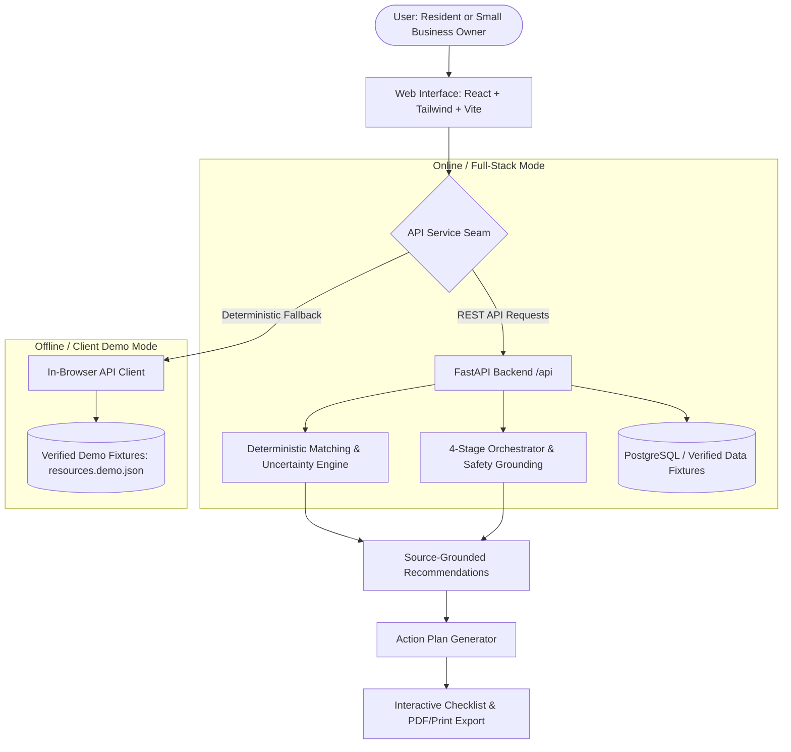
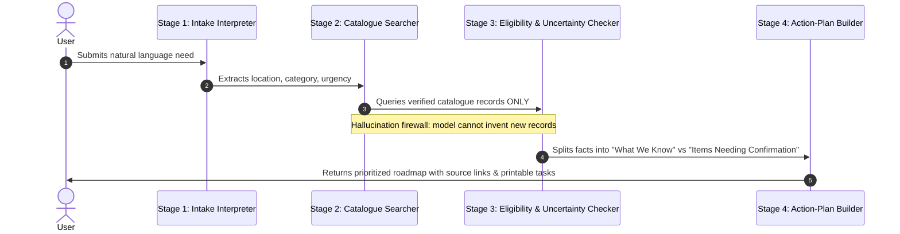

# BlockBridge AI — System Architecture & Technical Specification

> **Hackathon Track:** Black Code Collective Hacktoberfest — Track 3: Community Development  
> **Source of Truth:** `docs/PRD.md` & `docs/DESIGN_SYSTEM.md`

---

## 1. System Overview

BlockBridge AI is an AI-assisted community resource navigation platform designed to help residents and neighborhood small businesses discover verified support, evaluate eligibility uncertainties, and generate trackable action plans.



---

## 2. Monorepo Structure

```text
BlockBridge_AI/
├── apps/
│   ├── web/                         # React 18 + TypeScript + Vite + Tailwind CSS
│   │   ├── public/
│   │   │   └── bridge-icon.svg      # Custom brand bridge emblem
│   │   ├── src/
│   │   │   ├── components/
│   │   │   │   ├── common/          # Button, Badge, Modal, DemoBanner, Navbar, Footer
│   │   │   │   └── resources/       # ResourceCard, ReportIssueModal
│   │   │   ├── data/                # Embedded verified resource catalogue & scenarios
│   │   │   ├── pages/               # LandingPage, Catalogue, Detail, Guided Intake, Plan, Dashboard, Partners, Admin, Standards
│   │   │   ├── services/            # Dual-mode API Client (Live REST + Deterministic Seam)
│   │   │   ├── styles/              # index.css with CSS variables & print stylesheets
│   │   │   ├── types/               # TypeScript data models
│   │   │   ├── App.tsx              # Application shell & client-side routes
│   │   │   └── main.tsx             # React entry point
│   │   ├── package.json
│   │   ├── vite.config.ts
│   │   └── tailwind.config.js
│   └── api/                         # FastAPI Python Backend
│       ├── main.py                  # API endpoints, CORS, moderation queue
│       ├── models.py                # Pydantic schemas (Resource, Intake, Plan, Match, Report)
│       ├── matching.py              # Strict catalogue matching & uncertainty evaluation
│       └── requirements.txt
├── docs/
│   ├── PRD.md                       # Master Product Requirements Document
│   ├── VISUAL_DESIGN_PROMPT.md      # Visual & UX craft guidelines
│   ├── UI_IMPLEMENTATION_CHECKLIST.md # Granular build checklist
│   ├── DESIGN_SYSTEM.md             # Design tokens, typography & component rules
│   ├── ARCHITECTURE.md              # System design & data flow
│   └── DEMO_SCRIPT.md               # 3-minute hackathon live presentation script
├── sample-data/
│   ├── resources.demo.json          # 12 human-verified Atlanta & Georgia programs
│   └── scenarios.demo.json          # Pre-loaded scenarios (Marcus & Keisha)
├── .env.example
├── .gitignore
└── package.json                     # Monorepo workspace configuration
```

---

## 3. Technology Choices & Justification

| Layer | Technology | Justification |
| :--- | :--- | :--- |
| **Frontend Framework** | **React 18 + TypeScript + Vite** | Instant HMR development, strict compile-time type safety, zero build bloat, and fast initial page load. |
| **Styling & Design System** | **Tailwind CSS + CSS Custom Properties** | Complete token control for warm civic editorial palette (`--bb-bg: #FAF8F3`, `--bb-brand: #246B52`), WCAG 2.2 AA compliant contrast, responsive utility classes. |
| **Typography** | **DM Serif Display & DM Sans** | Combines dignified human editorial elegance (serif headings) with hyper-legible clean UI sans-serif. |
| **Icons** | **Lucide React** | Consistent, accessible, light-weight icon system. |
| **Backend Framework** | **FastAPI (Python 3.13)** | Asynchronous high-performance REST API, automatic OpenAPI / Swagger documentation, and Pydantic runtime schema validation. |
| **Resilience Seam** | **Dual-Engine Client Service** | Seamlessly executes both against the live FastAPI backend and as an autonomous in-browser engine. Judges can inspect both live API execution and zero-dependency offline demos. |

---

## 4. The 4-Stage AI Orchestration Pipeline

To satisfy the core PRD mandate that **"AI is a guide and organizer, not an authority on benefits or eligibility"**, the orchestration engine divides processing into four inspectable stages:



---

## 5. Security, Privacy & Integrity Guarantees

1. **Zero Exposure of Secrets:** Client bundles contain no private API keys or database service-role tokens. `.env.example` contains only benign placeholders.
2. **Zero Ingestion of Sensitive Identifiers:** No Social Security numbers, banking logins, immigration papers, or medical records are requested or accepted.
3. **No Fabricated Impact Metrics or Partners:** The landing page explicitly avoids fake testimonials, fake user numbers, or unverified organization logos.
4. **Moderation Audit Queue:** All proposed updates and corrections from community partners are stored with `Pending` status and require reviewer authorization before public listing.
